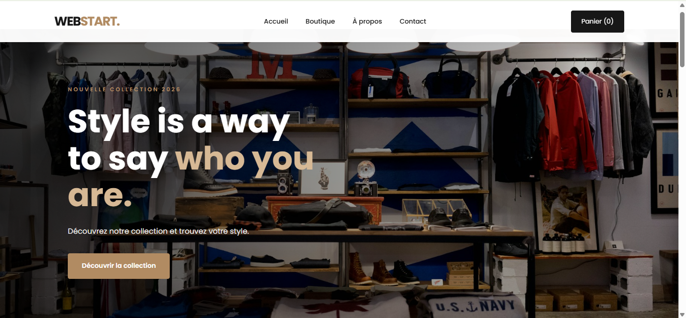
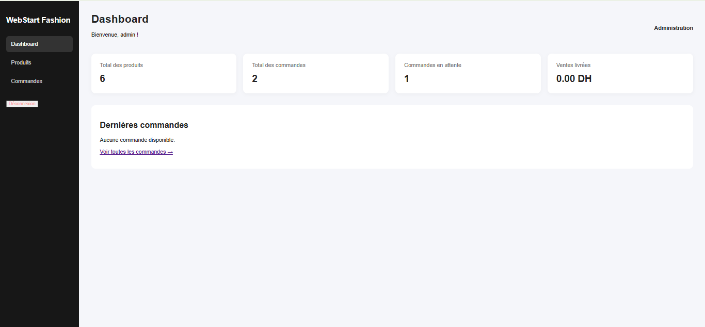

# WebStart Fashion

**WebStart Fashion** est un site e-commerce de démonstration dédié à la vente de vêtements. Il permet aux clients de consulter les produits, choisir leurs options et passer des commandes en ligne.

## Fonctionnalités

### Espace client
- Affichage des produits depuis MySQL.
- Recherche et filtrage par catégorie.
- Consultation des détails des produits.
- Sélection de la taille et de la couleur.
- Panier avec gestion des quantités.
- Formulaire de validation des commandes.
- Interface responsive adaptée aux mobiles et ordinateurs.

### Espace administrateur
- Authentification sécurisée.
- Tableau de bord avec statistiques.
- Gestion des produits (ajout, modification et suppression).
- Consultation des commandes.
- Modification du statut des commandes.

## Technologies utilisées

- HTML5
- CSS3
- JavaScript
- PHP
- MySQL
- PDO
- XAMPP

## Installation locale

1. Installer XAMPP.
2. Copier le dossier `webstart-fashion` dans `C:\xampp\htdocs\`.
3. Démarrer Apache et MySQL.
4. Ouvrir phpMyAdmin.
5. Créer la base de données `webstart_fashion`.
6. Importer le fichier SQL de sauvegarde.
7. Vérifier la configuration de connexion dans `config/database.php`.
8. Ouvrir le site :

`http://localhost/webstart-fashion/`

## Structure du projet

- `index.html` : interface principale.
- `css/` : feuilles de style.
- `js/` : fonctionnalités JavaScript.
- `images/` : images du site.
- `config/` : configuration et sécurité.
- `api/` : API PHP pour les produits et commandes.
- `admin/` : espace d'administration.

## Objectif du projet

Ce projet a été réalisé dans le cadre de mon apprentissage en développement Web Full Stack afin de mettre en pratique HTML, CSS, JavaScript, PHP et MySQL.

## Captures d'écran

### Page d'accueil

### Catalogue des produits

### Tableau de bord administrateur

## Statut

Projet de démonstration et d'apprentissage — non destiné à être utilisé directement en production sans audit et configuration supplémentaires.